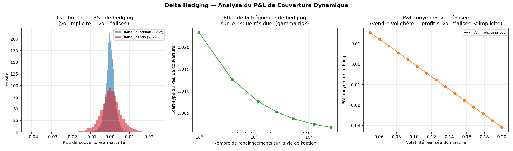
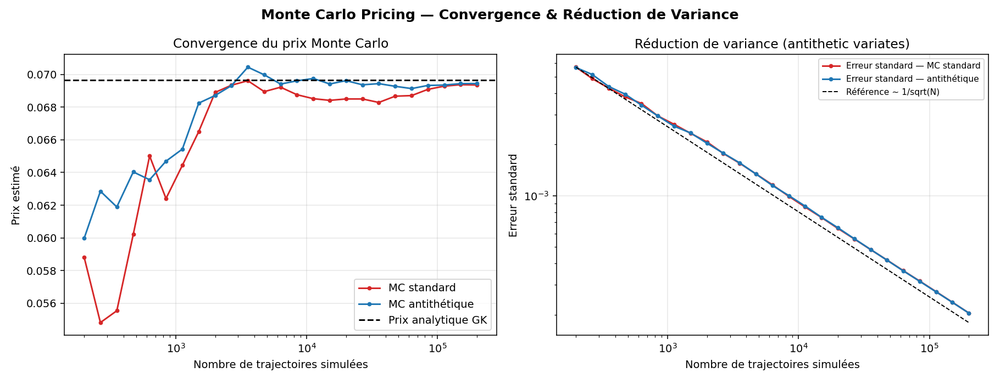
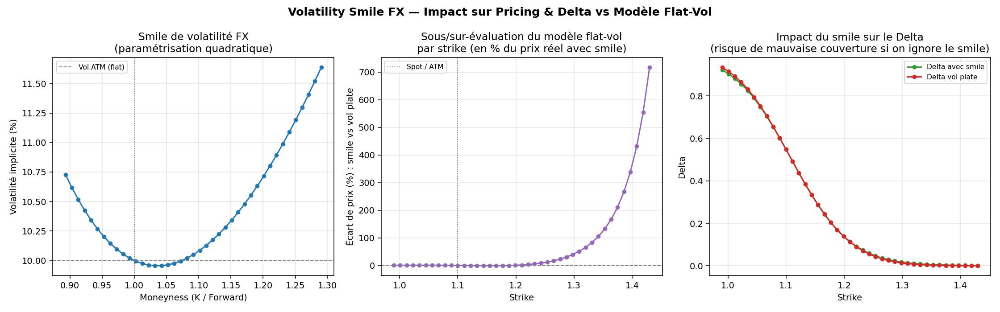
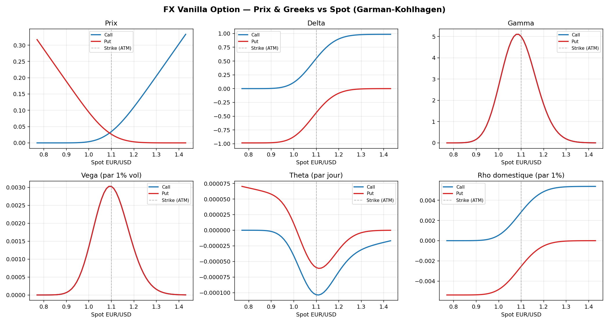
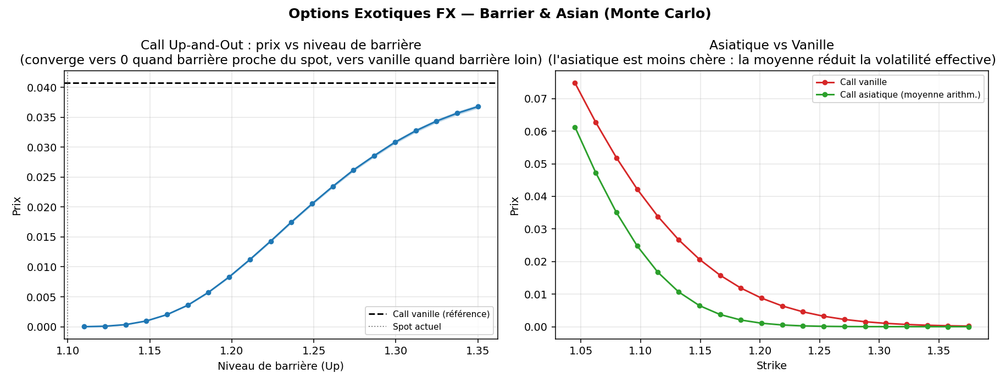

# FX Derivatives Pricing & Hedging Engine

A Python engine for pricing and risk-managing FX options: from a closed-form
vanilla pricer to Monte Carlo exotics, dynamic delta hedging and the impact
of the volatility smile.

*Version française : [README.fr.md](README.fr.md)*

## Features

| Module | What it does |
|---|---|
| **Pricing & Greeks** (`garman_kohlhagen.py`) | Garman-Kohlhagen model (Black-Scholes for FX, with domestic and foreign rates). Price, delta, gamma, vega, theta, domestic and foreign rho. |
| **Implied volatility** (`implied_volatility.py`) | Inverts the model to recover the volatility from an observed price (Brent's method, with no-arbitrage bounds checks). |
| **Monte Carlo** (`monte_carlo.py`) | Exact GBM simulation under the domestic risk-neutral measure, antithetic variates, 95% confidence intervals. Validated against the closed-form price. |
| **Exotic options** (`exotics.py`) | Barrier options (up/down, knock-in/knock-out, discrete monitoring) and Asian options (arithmetic and geometric averages), priced by Monte Carlo. |
| **Delta hedging** (`hedging.py`) | Simulates a dealer who sells an option and delta-hedges it. Shows how hedging P&L variance falls with rebalancing frequency, and the P&L created when realised volatility differs from implied volatility. |
| **Sensitivities** (`sensitivity.py`) | Price as a function of spot, volatility and time to maturity. |
| **Volatility smile** (`vol_smile.py`) | Quadratic smile in log-moneyness and the pricing/delta error made when a flat ATM volatility is used for every strike. |

## Results

| Monte Carlo vs closed form | Volatility smile |
|---|---|
|  |  |

| Pricing & Greeks | Exotic options |
|---|---|
|  |  |

## Validation

`tests/test_pricing.py` checks the engine against known relationships:

- put-call parity on the closed-form prices;
- implied volatility round-trip (price -> vol -> price);
- Monte Carlo price converging to the Garman-Kohlhagen price;
- barrier in-out parity (knock-in + knock-out = vanilla);
- delta bounds and positive gamma.

All tests pass.

## Project structure

- `src/` : pricing engine (`garman_kohlhagen.py`, `implied_volatility.py`, `monte_carlo.py`, `exotics.py`, `hedging.py`, `sensitivity.py`, `vol_smile.py`)
- `examples/` : one script per module, generates the charts
- `outputs/` : generated charts
- `tests/` : validation tests

## Getting started

    pip install -r requirements.txt
    python tests/test_pricing.py
    python examples/01_pricing_and_greeks.py

Each script in `examples/` reproduces one chart in `outputs/`.

## Limitations and next steps

- Exotics are priced by simulation only (no closed-form barrier formulas yet).
- The smile is a simple quadratic parametrisation, not an arbitrage-free model such as SABR or SVI.
- The hedging simulation ignores transaction costs.

## Tools

Python, NumPy, SciPy, Pandas, Matplotlib.
